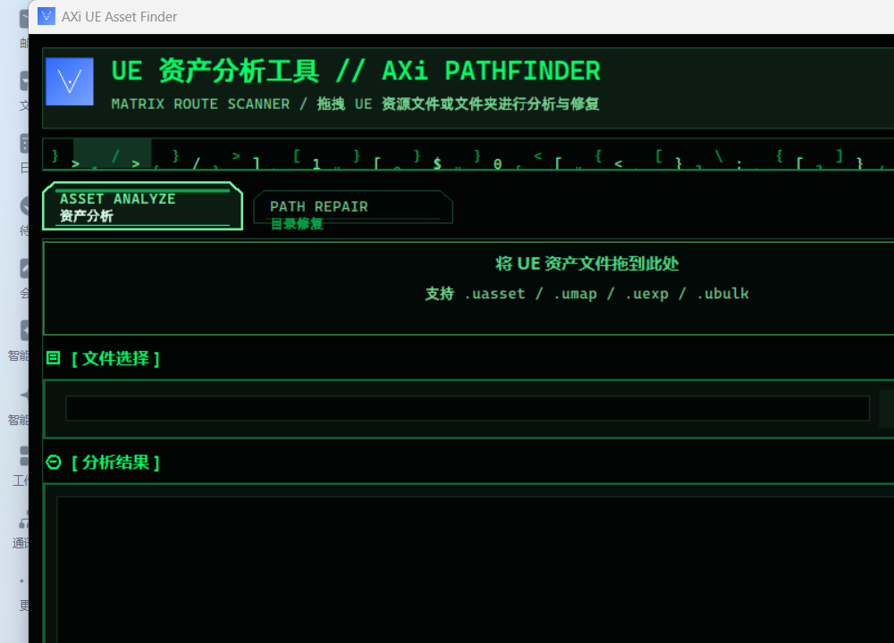

# AXi Unreal Asset Finder

面向 Unreal Engine 资产迁移、整理、更新和排错的桌面工具。它可以直接分析
`.uasset` / `.umap` / `.uexp` / `.ubulk` 文件，提取 UE 内路径、版本信息、
关联文件和导入引用，提供目录重命名修复辅助，并比较新旧资产目录。

当前版本：`v2.0.1`

## 功能

- 资产分析：读取 UE 资产头、版本信息、文件大小、特征文本和关联文件。
- UE 路径提取：从二进制内容中提取 `/Game/...` 或 `/Engine/...` 路径。
- 引用查看：解析可见导入/引用字符串，并按目录层级显示为脑图风格结构。
- 拖拽操作：支持拖入资产文件或资产文件夹。
- 目录修复：校验目录内资产路径，支持不同长度目录名变更、二次确认和安全副本模式。
- CLI 模式：可从命令行快速转换单文件或目录路径。
- 资产更新比对：按相对路径和完整文件内容比较 Old / New 文件夹。
- 差异筛选：显示新增、修改、删除，支持逐项勾选和批量选择。
- 差异包导出：保持 New 目录结构，删除路径写入 `diff_manifest.json`。
- Windows 打包：通过 PyInstaller 生成免安装发行包。

## 快速开始

### 使用发行版

1. 下载 GitHub Release 中的 `UEAssetPathFinder-v2.0.1-win64.zip`。
2. 解压后运行 `UEAssetPathFinder.exe`。
3. 拖入 UE 资产文件或资产文件夹。

### 从源码运行

```powershell
python -m venv .venv
.\.venv\Scripts\Activate.ps1
pip install -r requirements.txt
python main.py
```

CLI：

```powershell
python main.py -cli
python main.py "D:\Project\Content\Characters\Hero.uasset"
python main.py "D:\Project\Content\Characters"
```

运行测试：

```powershell
python -m unittest -v test_asset_diff.py
python test_parser.py
```

## 资产更新比对

1. 打开“资产更新比对”标签页。
2. 拖入 Old（旧版本）与 New（新版本）文件夹，也可使用浏览按钮。只要一侧位于真实 `Content` 内或其上层，程序即可计算 `/Game` 路径；另一侧允许是下载得到的独立更新目录。
3. 点击“开始比对”。
4. 点击结果首列切换单项导出状态；也可多选行后按空格。
5. 点击“导出所选”或“全部导出”，再选择保存位置。

导出结构：

```text
UEAssetDiff_YYYYMMDD_HHMMSS/
├─ Content/                 新增、修改文件；从 /Game 根递归到真实路径
└─ diff_manifest.json       完整差异元数据、Content 路径、/Game 路径及删除路径
```

当一侧为独立目录时，它继承另一侧所选目录对应的 `/Game` 前缀。例如 Old 位于 `Content/Characters/YanHe/YH_001_10TH`，New 可直接选择下载的 `YH_001_10TH`。Content 外部的 `.uasset` 等文件不参与项目根扫描。若双方都无法建立 Content 映射，程序会报错但不会阻塞界面。导出不会生成重复的 `Content/Content`。删除文件不会从 Old 复制到包中；使用 `deleted_paths` 或 `deleted_game_paths` 驱动下游删除操作。

比对不读取文件修改时间。大小不同标记为“修改·大小”；大小相同则逐块读取完整字节，内容不同标记为“修改·内容”。UE 包头 GUID 等元数据属于文件内容，因此变化时也会被精确模式识别。

## 界面



截图为 v1.2.1 无弹窗静默目录修复界面状态。v2.0.0 保留 Matrix 视觉和既有资产
分析、目录修复界面，并增加“资产更新比对”标签页。

界面特征：

- 绿色终端配色
- 自绘标题栏和棱角化窗口边缘
- AX Matrix 软件图标
- 顶部扫描条和代码流扫过动画
- 拖拽区域霓虹脉冲
- 终端风结果面板
- 暗色表格、药丸模式滑块、弹窗和状态条
- 文本选区使用亮绿底和深色字反转显示

资产分析和目录检测都会显示代码流扫过动画。

## 目录修复安全规则

目录修复只在路径校验通过后启用。

- 默认使用“副本粘贴模式”，先复制目录再修改副本。
- “副本粘贴模式”和“原位更改模式”通过药丸滑块切换。
- 切换到“原位更改模式”时会提示“该操作可能不可逆，注意备份！”。
- 执行目录变更前会提示外部引用风险。
- 新旧目录名长度不一致时允许继续，但会额外弹出二次确认。
- 只替换已识别的旧 `/Game/.../` 前缀。

## 项目结构

```text
main.py                         程序入口，选择 GUI / CLI / 快速转换
gui_dnd.py                      当前 GUI、拖拽、分析、修复、比对与导出
asset_diff.py                   资产文件夹精确比对与差异包导出
ue_parser.py                    UE 资产解析和路径提取
asset_finder.py                 文件路径到 UE Content 路径的转换逻辑
config.py                       默认配置和版本号
requirements.txt                Python 依赖
build_exe.spec                  PyInstaller 打包配置
assets/                         GUI 和 Windows 图标、界面截图
test_parser.py                  解析器基础测试
test_asset_diff.py              比对与导出单元测试
test_asset.uasset               测试资产样例
DEVELOPMENT.md                  开发、架构、测试、打包说明
RELEASE_NOTES.md                完整版本历史
RUST_EVALUATION.md              Rust 性能评估结论
rust_diff_probe/                Rust 性能评估原型
benchmarks/benchmark_diff.py    Python / Rust 可复现基准
```

## 构建

```powershell
.\.venv\Scripts\Activate.ps1
pip install -r requirements.txt
pyinstaller --clean --noconfirm build_exe.spec
```

构建完成后输出：

```text
dist\UEAssetPathFinder\UEAssetPathFinder.exe
```

## Rust 性能探索

`rust_diff_probe/` 是无第三方依赖的目录扫描与精确字节比对原型。生产版
v2.0.0 当前使用优化后的 Python 后台线程实现，避免增加外部二进制和 IPC
复杂度。实测数据、边界与后续接入条件见
[RUST_EVALUATION.md](RUST_EVALUATION.md)。

复现基准：

```powershell
cargo build --release --manifest-path rust_diff_probe\Cargo.toml
python benchmarks\benchmark_diff.py `
  --rust-bin rust_diff_probe\target\release\ue_asset_diff_probe.exe `
  --files 128 --size-mb 4 --runs 5
```

## 已知限制

- 加密、压缩或自定义格式资产可能无法完整解析。
- 超大资产只读取有限范围用于路径扫描，结果可能不完整。
- 不等长目录名变更会修改二进制路径长度，执行前必须确认已有备份。
- CLI 中部分旧文本仍保留历史编码，GUI 主流程已可读。
- 更新比对仅处理 `.uasset`、`.umap`、`.uexp`、`.ubulk`。
- 更新比对基于相对路径和完整字节，不解析资产语义差异。
- 删除项仅记录于清单，工具不会自动删除目标文件。
- 大目录首次比对受磁盘读取速度影响；缓存基准不能等同于冷盘性能。
